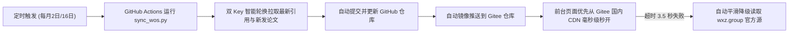

# 王小治教授课题组 · Web of Science 官方权威学术成果展示系统
> **Clarivate Web of Science (科睿唯安官方核心合集数据库) 官方直连双 Key 自动化系统**  
> 课题组官方网址：[wxz.group](https://wxz.group) | 学者 ResearcherID：[PDX-5463-2025](https://www.webofscience.com/wos/author/record/PDX-5463-2025)

---

## 一、 系统架构与学术特性

本系统专为**扬州大学王小治教授课题组**量身打造，深度适配 [wxz.group](https://wxz.group) 官方科技宝蓝（`#1e50ae`）与天青色（`#0284c7`）视觉风格，并全面契合课题组**环境材料、土壤修复与化学工程**的学科特色。

### 🌟 核心功能规范：
1. **官方权威直连与动态指标**：
   - 直通 **Clarivate Web of Science Starter API**，实时获取 **6,680+** 次总被引频次与 **44** H 指数；
   - 2016–2026 近十年发文量与被引频次柱状趋势图由数据动态驱动，实现全自动无感更新。
2. **高精度环境材料化工 6 大特色研究主题**：
   - 融合论文标题、期刊名称与 Web of Science 官方作者关键词（`authorKeywords`）深度分析：
     - `光催化与环境材料` (81 篇)
     - `高级氧化与铁循环` (86 篇)
     - `重金属吸附与修复` (76 篇)
     - `生物炭与多孔材料` (65 篇)
     - `土壤生态与碳氮循环` (49 篇)
     - `新兴污染物与健康` (30 篇 · 新增高频方向：微塑料、抗生素、室内甲醛净化)
3. **历史数据固化机制（2025年及以前）**：
   - 2025 年及以前的既定文献，其标题、作者、期刊、卷期页码、DOI 与主题分类已完全固化锁定；
   - 每次同步仅动态刷新其实时被引频次，保证历史数据永不偏移、极速加载。
4. **精选成果多维筛选与双模式排序**：
   - 精选成果支持按：`【全部】`、`【★ 代表作 Selected】`（默认高亮）、`【🔥 ESI高被引】`、`【👥 通讯/第一作者】` 进行精准过滤；
   - 论文编号与标题在同一行优雅呈现（纯数字无 `#` 号，如 `210. Triple-Network...`）；
   - 文章卡片内显式展示可点击的 `DOI: 10.xxxx/...` 标签，且页码与论文编号经过规范清洗，彻底杜绝字典脏数据。
5. **双 API Key 智能轮换与绝密安全机制**：
   - 系统支持双 API Key 智能随机轮询与配额超额自动接力切换；
   - **代码零明文泄露**：API Keys 绝对不以明文形式上传到 GitHub/Gitee，本地从私密忽略文件读取，云端由 GitHub Secrets 环境变量注入。
6. **凡科网（CMS）1200px 标准等宽与 50,000 字符限制适配**：
   - 双模块外层均采用标准 1200px 版心，左右边框垂直像素级对齐；
   - 模块一体积约 **24KB**，模块二体积约 **46KB**，均严格低于凡科 **50,000 字符**限制。

---

## 二、 为什么要传 publications_data.js 到 wxz.group？

许多老师初次使用时常有疑问：*“为什么凡科网不能把所有文章直接写进 HTML，还要把 js 文件传到 wxz.group？”*

1. **凡科网的字数天花板（50,000 字符限制）**：
   - 王小治教授课题组目前收录了 **202 篇** 高水平论文；
   - 包含了每篇论文的中英文标题、全部作者、期刊卷期、DOI、被引频次、代表作/ESI高水平标记、6大研究主题；
   - 完整的数据量达 **150 KB（超过 15 万字）**。如果直接写在凡科网的插件代码框里，凡科网会直接报错拒绝保存！
2. **“动静分离”的高性能网站架构**：
   - 凡科网里的两个 HTML 模块仅负责**骨架与交互**（卡片布局、筛选逻辑、柱状图绘制），体积只有 24KB/46KB，永久安全运行；
   - 数据文件（`publications_data.js` 和 `impact_data.js`）存放在外部服务器上；
   - 每次访问网页时，用户的浏览器会自动秒级拉取最新数据。
   - **只要把这两个 js 文件放在 wxz.group 服务器根目录下**，网页就能顺利读取展示！
   - **配置好 GitHub 和 Gitee 之后**，网页还可以直接从 Gitee 国内极速 CDN 自动拉取，连手动上传服务器都可以省去！

---

## 三、 GitHub 与 Gitee 双平台全自动云同步搭建教程

通过配置 GitHub Actions 与 Gitee 镜像仓库，即可实现**全自动无人值守云同步**：

### 第一步：在 GitHub 创建私有/公开仓库并上传代码
1. 登录 [GitHub](https://github.com)，点击右上角 **New repository**，新建一个仓库（例如命名为 `wxz-pub`）；
2. 将本地 `wxz-pub` 文件夹内的代码推送到该仓库；
3. **注意**：本地的 `wos_secrets.local.json` 已经被 `.gitignore` 保护，**绝不会上传到 GitHub**，API Key 绝对安全！

### 第二步：在 GitHub 仓库中配置安全 Secrets（注入 API Key）
1. 打开您的 GitHub 仓库页面，点击顶部 **Settings**；
2. 在左侧菜单点击 **Secrets and variables** $\rightarrow$ **Actions**；
3. 点击绿色按钮 **New repository secret**，依次添加以下安全密钥：

| Secret 名称 | 填入内容 | 作用 |
| :--- | :--- | :--- |
| **`WOS_API_KEY_1`** | `<您的 Clarivate WoS 官方 API 主密钥>` | 第 1 组 Clarivate WoS 官方 API 密钥 |
| **`WOS_API_KEY_2`** | `<您的 Clarivate WoS 官方 API 备用密钥>` | 第 2 组 Clarivate WoS 官方 API 密钥（智能接力） |
| **`GITEE_USER`** | 您的 Gitee 用户名 | 用于镜像推送到 Gitee（选填） |
| **`GITEE_REPO`** | 您的 Gitee 仓库名（如 `wxz-pub`） | 用于镜像推送到 Gitee（选填） |
| **`GITEE_TOKEN`** | 您的 Gitee 私人令牌（Personal Access Token） | 授权 GitHub 自动向 Gitee 写入代码（选填） |

> **安全保障**：GitHub Secrets 中的内容经过银行级非对称加密存储，任何人（包括仓库访客）都无法查看明文，仅供 GitHub Actions 运行瞬间在内存中安全读取！

### 第三步：配置 Gitee 镜像仓库与私人令牌（国内毫秒级 CDN）
1. 登录 [Gitee (码云)](https://gitee.com)，新建一个同名公开仓库（如 `wxz-pub`）；
2. 获取 Gitee 令牌：点击 Gitee 右上角头像 $\rightarrow$ **设置** $\rightarrow$ **私人令牌** $\rightarrow$ **生成新令牌**；
   - 勾选权限：`projects`（项目管理）；
   - 生成后将该令牌填入 GitHub Secrets 的 `GITEE_TOKEN` 中。
3. 之后，每当 GitHub Actions 在每月 2 号和 16 号更新完数据，就会自动把最新成果推送到 Gitee！
4. 此时您的 Gitee 国内高速 CDN 直链地址为：
   - 论文数据：`https://gitee.com/<您的Gitee用户名>/wxz-pub/raw/master/publications_data.js`
   - 影响力数据：`https://gitee.com/<您的Gitee用户名>/wxz-pub/raw/master/impact_data.js`

---

## 四、 凡科建站后台部署步骤

1. **部署数据文件（首次上线）**：
   将本目录下的 [publications_data.js](file:///e:/OneDrive%20-%20Jiangsu%20University/%E5%B7%A5%E4%BD%9C/5.%E5%AE%9E%E9%AA%8C%E5%AE%A4%E7%AE%A1%E7%90%86/%E7%BD%91%E7%AB%99/wxz/wxz-pub/publications_data.js) 与 [impact_data.js](file:///e:/OneDrive%20-%20Jiangsu%20University/%E5%B7%A5%E4%BD%9C/5.%E5%AE%9E%E9%AA%8C%E5%AE%A4%E7%AE%A1%E7%90%86/%E7%BD%91%E7%AB%99/wxz/wxz-pub/impact_data.js) 上传至 `wxz.group` 网站主机根目录（通过宝塔面板 / FTP 均可）；
2. **嵌入模块一（学术影响力大屏 · 1200px 严丝合缝）**：
   - 打开凡科网后台，进入“论文成果/科研成果”页面；
   - 添加“插件代码/自定义 HTML”模块；
   - 复制 [凡科_模块1_学术影响力.html](file:///e:/OneDrive%20-%20Jiangsu%20University/%E5%B7%A5%E4%BD%9C/5.%E5%AE%9E%E9%AA%8C%E5%AE%A4%E7%AE%A1%E7%90%86/%E7%BD%91%E7%AB%99/wxz/wxz-pub/%E5%87%A1%E7%A7%91_%E6%A8%A1%E5%9D%971_%E5%AD%A6%E6%9C%AF%E5%BD%B1%E5%93%8D%E5%8A%9B.html) 的全部代码粘贴进去并保存；
3. **嵌入模块二（成果筛选与卡片流 · 1200px 严丝合缝）**：
   - 在模块一下方再次添加一个“插件代码/自定义 HTML”模块；
   - 复制 [凡科_模块2_成果与筛选.html](file:///e:/OneDrive%20-%20Jiangsu%20University/%E5%B7%A5%E4%BD%9C/5.%E5%AE%9E%E9%AA%8C%E5%AE%A4%E7%AE%A1%E7%90%86/%E7%BD%91%E7%AB%99/wxz/wxz-pub/%E5%87%A1%E7%A7%91_%E6%A8%A1%E5%9D%972_%E6%88%90%E6%9E%9C%E4%B8%8E%E7%AD%9B%E9%80%89.html) 的全部代码粘贴进去并保存；
4. 点击凡科网后台右上角 **“保存并发布”** 即可在 [wxz.group](https://wxz.group) 完美呈现！
